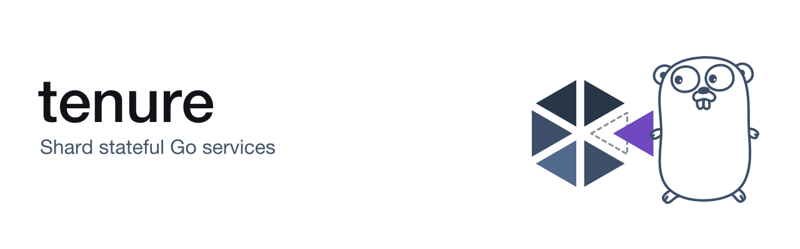

[](LICENSE) [](https://github.com/hmdsefi/tenure/actions/workflows/build.yml?query=branch%3Amain)

# tenure

<p align="center">
  <picture>
    <source media="(prefers-color-scheme: dark)" srcset=".github/assets/readme-dark.svg">
    
  </picture>
</p>

**Shard stateful Go services: every shard has one owner at a time, and a stale owner's writes can be
rejected.**

> **Status: v0.2.0, which adds routing: a `Router` that any process embeds to send each request
> straight to its shard's owner.** The root module and the `k8s` and `grpcroute` modules are
> tagged and can be imported; the API may still change before v1.0.0. Later work is planned as
> public issues: see the pinned roadmap issue and the
> [milestones](https://github.com/hmdsefi/tenure/milestones).

Some services can't be scaled by adding replicas, because each piece of their state needs exactly
one writer: a relayer's signer per wallet (two signers reuse a nonce), a matching engine per market
(two matchers double-fill), an order manager per account, an indexer per chain. Sharding them safely
takes membership, placement, leases, fencing and a clean handoff, so many teams run one instance in
production instead. tenure is a library that does that part.

## How it will work

You give tenure a `Run` function per space of shards. tenure calls it on the member that owns a
shard, and cancels its context when ownership ends:

```go
kube := k8s.New(client, "trading", "orderbook") // namespace, group

node, err := tenure.Start(ctx, tenure.Config{
	Self:       tenure.Member{ID: os.Getenv("POD_NAME"), Addr: os.Getenv("POD_IP") + ":8080"},
	Membership: kube,
	Store:      kube,
	Slots:      3, // one per replica: a rollout moves each shard once
	Spaces: []tenure.Space{{
		Name:   "markets",
		Shards: 64,
		Fenced: true,
		Run: func(ctx context.Context, s *tenure.Shard) error {
			// This member owns shard s.ID until ctx is done.
			// Raise the shard's fence to s.Term before reading state,
			// then write fills in transactions that check the fence.
			return serveMarkets(ctx, s)
		},
	}},
})
```

- **Spaces.** Keys hash into a fixed number of shards. Each shard is held by one member at a time,
  under a lease in a store: Kubernetes Leases by default (one RBAC rule, no extra infrastructure),
  Postgres or etcd later.
- **Terms.** Every acquisition gets a term, a number that only grows. A lease alone can't stop a
  paused process, so tenure doesn't pretend it can: a downstream that checks the term at a per-shard
  fence point rejects a stale owner's writes. tenure provides the helper for Postgres.
- **Clean handoffs.** On `SIGTERM`, a member stops its runs, releases its shards and its slot, and
  the next member starts at once instead of waiting for leases to expire.
- **Routing.** tenure tells you which member owns a key, inside the group (`node.Route`) and in any
  process that sends requests (`tenure.Router`); you keep your own gRPC or HTTP server and
  serialization.
- **A resolver** for keys that don't need strict ownership, and **partition trees** that split one
  hot key across members, the way Temporal's matching service splits task queues.

All decisions (assignment, placement, ownership state, timing) live in a pure, deterministic
package, `tenure/core`, with no dependencies outside the standard library. It is tested with
deterministic simulation in [faultline](https://github.com/hmdsefi/faultline), and
[lockstep](https://github.com/hmdsefi/lockstep) will use it for placing virtual actors.

## Routing requests

A process outside the group, such as a client, another service or a proxy you write, sends each
request straight to its owner with a `tenure.Router`. The Router follows the group's views,
computes the members' table, and answers a lookup with a hash and two array reads, without a lock
or an allocation. Here it follows the Leases with a watch-only Adapter, and an HTTP client sends
every request of the markets space to its owner through `routehttp.Transport`:

```go
kube := k8s.New(client, "trading", "orderbook", k8s.WithWatchOnly()) // reads Leases, writes none
router, err := tenure.NewRouter(kube, spaces)                        // the members' own []tenure.Space
if err != nil {
	return err
}
markets := &http.Client{Transport: &routehttp.Transport{
	Router: router, Space: "markets", Key: marketOf,
	Fallback: "orderbook.trading.svc:8080", // any member, until the Router has a view
}}
```

The Transport follows a member's `421` redirect when the Router's view lags, and `grpcroute` does
the same for gRPC; `router.Route("markets", key)` names the owner for your own code. tenure
ships these packages and no gateway or routing service. The [routing guide](docs/routing.md)
says which pattern fits which service, how to serve views to many routers through a relay,
and what lookups and rebuilds cost.

## What it doesn't do

tenure moves ownership, not data: it stores no user state, runs no consensus algorithm of its own,
offers no cross-shard transactions and carries no requests. Beyond the routing measurements that
the routing guide publishes with their method, it makes no performance claims until published
benchmarks back them.

## Proof of work

Besides lockstep, the plan includes running [Temporal](https://github.com/temporalio/temporal) on
tenure instead of Ringpop: first a fresh cluster, then a live cluster migrated step by step, with
benchmarks against Ringpop, losses included.

## Contributing

Bug reports, fixes and tests are welcome. The [contributor guide](.github/CONTRIBUTING.md)
explains how to build and test tenure, the determinism rules of `core`, and the commit conventions.

## License

[MPL-2.0](LICENSE).

The Go gopher was designed by Renée French. The gopher in the banner is line art made from Takuya
Ueda's [gopher vector](https://github.com/golang-samples/gopher-vector), licensed under
[CC BY 3.0](https://creativecommons.org/licenses/by/3.0/).
